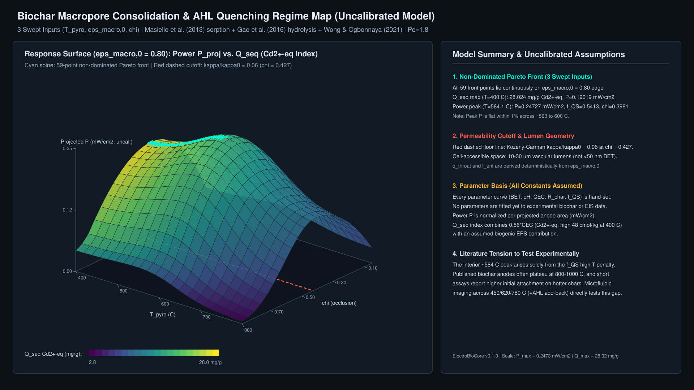

# ElectroBioCore

Open-source Julia framework for **porous biochar electro-fermentation**, **quorum-sensing (QS) signal quenching**, **vascular macropore entrainment**, and **viscoelastic EPS biofilm rheology**.

**Important Modeling Caveat (Uncalibrated v0.1.0):** Every parameter and closed-form curve in this repository is currently **assumed** rather than fitted to experimental biochar, EIS, or microfluidic biofilm data. The included [`calibration/synthetic_recovery_receipt.json`](calibration/synthetic_recovery_receipt.json) is a synthetic parameter-recovery self-test only, not an empirical fit.

Companion repository to [`aurascoper/Biofilms`](https://github.com/aurascoper/Biofilms).



*(An extended 2-panel view including Panel B's simulated 14-day trajectories under assumed kinetics is at [`outputs/Figure1_Biochar_Regime_Map.svg`](outputs/Figure1_Biochar_Regime_Map.svg); Panel B shows uncalibrated model curves, not experimental pilot data.)*

---

## Physical Scope & Coupled Transport Gates

Simple regressions on static `N2` BET surface area and dry electrical conductivity miss the pore-scale bottlenecks of real lignocellulosic biochars. Essentially all `N2` BET area resides in sub-`50 nm` nanopores inaccessible to `1-2 um` cells, whereas cell colonization is confined to `10-30 um` vascular vessel and tracheid lumens. Meanwhile, solid-matrix biochar conductivity rises by many orders of magnitude between `400` and `800 C` (and published biochar MFC anodes plateau or improve up to `800-1000 C`; e.g., Antic Gorrazzi et al., 2023). `ElectroBioCore` sweeps **3 independent inputs** (`T_pyro` in `400-800 C`, initial macroporosity `eps_macro,0` in `0.35-0.80`, and lumen occlusion `chi` in `0.05-0.88`, with `d_throat` and `f_ent` derived from `eps_macro,0`) to test the competing hypothesis that signal quenching penalizes high-temperature biochars:

1. **Pore-Scale Consolidation (`chi`), Bruggeman Hindrance & Kozeny-Carman Necking**
   Tracks lumen biofilm volume fraction `chi in [0, 0.94]`, balancing matrix percolation against Bruggeman substrate hindrance `(1 - chi)^tau_B` and mean-field Kozeny-Carman permeability loss `(1 - chi)^3 / (1 + 1.8 * chi)^2` (a mean-field closure that generally underestimates abrupt streamer clogging). `kappa/kappa_0 = 0.06` imposes a permeability cutoff near `chi = 0.427` in stationary flow.
2. **AHL Signal Quenching (`f_QS`) vs. Macropore Entrainment (`f_ent`)**
   Following Masiello et al. (2013) on nanoporous sorption of Gram-negative acyl-homoserine lactone (AHL) autoinducers and Gao et al. (2016) on pH-dependent lactone hydrolysis, high-BET/high-pH chars produced at `720-800 C` quench AHL accumulation (`f_QS = 0.1358` at `780 C` natively), predicting a dispersed maturation lag unless rescued (e.g., exogenous `+AHL` add-back). Separately, Wong & Ogbonnaya (2021) review how char macro-architecture governs microbial carriage; here `f_ent(eps_macro,0, Pe)` models cell retention inside `15-25 um` lumens.
3. **Viscoelastic EPS Biofilm Rheology (`G'`, `G''`, `tan(delta)`, `tau_yield`)**
   `ViscoelasticRheology.eval_eps_rheology` maps `chi` and `f_QS` into Maxwell-Jeffreys complex shear moduli `G*(omega) = G' + i G''`. Under assumed gelation scaling (`chi_gel = 0.16`), high-`T` QS-inhibited biofilms remain loss-dominant sols (`tan(delta) > 3.0`), whereas intermediate-`T` or `+AHL`-rescued biofilms cross into an elastic gel regime (`G' ~ 30-41 Pa`, `tan(delta) ~ 0.48-0.62`).

---

## Preliminary Uncalibrated Pareto Front & Rheology Benchmarks (`outputs/electrobio_pareto_front.csv`)

Evaluating the `3`-input feasible grid yields a continuous **`59`-point non-dominated Pareto front** spanning `400.0 C` to `584.13 C` along `eps_macro,0 = 0.80` (projected-area power `P_proj` is flat within `1%` across `~563-600 C` in the surface and across `565.1-584.1 C` on the feasible front). All rows below are computed directly from `export_biochip_5d_pareto.jl` (`eps_macro,0 = 0.80`, `Pe_flow = 1.80`, `Pe_osc = 0.0`) and `eval_eps_rheology(chi, f_QS; f_drive_Hz = 1.25)`:

| Regime / Anchor | `T_pyro` (C) | `f_QS` | `chi` | `G'` (Pa) | `G''` (Pa) | `tan(delta)` | `P_proj` (`mW/cm^2`, uncal.) | `Q_seq` `Cd2+-eq` (`mg/g`) |
|---|---:|---:|---:|---:|---:|---:|---:|---:|
| **Pareto Row 1 (Max `Q_seq`)** | `400.00` | `0.8887` | `0.4248` | `41.45` | `19.68` | `0.475` | `0.19019` | `28.024` |
| **Pareto Row 30 (Mid-Front)** | `488.89` | `0.7982` | `0.3981` | `33.51` | `18.59` | `0.555` | `0.21295` | `22.906` |
| **Pareto Row 59 (Max `P_proj`)** | `584.13` | `0.5413` | `0.3981` | `30.02` | `18.49` | `0.616` | `0.24727` | `18.387` |
| **`780.0 C` Native (Predicted QS Lag)** | `780.00` | `0.1358` | `0.2400` | `4.06` | `12.53` | `3.086` | `0.12021` | `10.636` |
| **`780.0 C + AHL` Rescue State (`>=0.84`)** | `780.00` | `0.8400` | `0.4200` | `39.49` | `19.47` | `0.493` | `0.22240` | `15.745` |

**Notes on Units, Normalization & Literature Context:**
- `P_proj` is uncalibrated power normalized to **projected anode area** (`1.9-2.5 W/m^2` vs. `0.46-0.53 W/m^2` measured by Huggins et al., 2014 normalized to cathode area).
- `Q_seq` is a **Cd2+-equivalent cation retention index** (`0.56 * CEC * (1 - 0.52 * chi) + biogenic_EPS`, attenuated by Bruggeman accessibility). The assumed `48 cmol/kg` CEC at `400 C` is an upper-bound surrogate (~5x typical wood-char values of ~10 cmol/kg).
- `R_char_ohm_cm2` and `R_ohm_eff_ohm_cm2` are area-specific resistances (`Ohm*cm^2`), not `Ohm/sq` sheet resistances.

---

## Quick Start (Julia >= 1.10, Zero Required Dependencies)

```bash
# 1. Run full package + byte-exact regeneration tests
julia --project=. -e 'using Pkg; Pkg.test()'

# 2. Re-export stationary non-dominated Pareto front CSV + 1-panel & 2-panel SVGs
julia --project=. scripts/export_biochip_5d_pareto.jl --out-dir outputs

# 3. Optional: Run pulsatile Peclet/Womersley strain-pumping sweep
# (Pass --use-jacc when JACC.jl is installed in your active environment)
julia --project=. scripts/export_biochip_5d_pareto.jl --pulsatile --pe-osc 2.2 --stride-hz 1.8 --out-dir outputs

# 4. Run synthetic parameter-recovery self-test (no empirical data fitted)
julia --project=. scripts/fit_lignocellulosic_curves.jl --synthetic-recovery --emit-json calibration/synthetic_recovery_receipt.json
```

---

## License

Released under the [MIT License](LICENSE).
